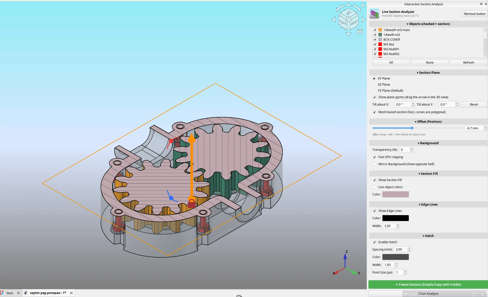
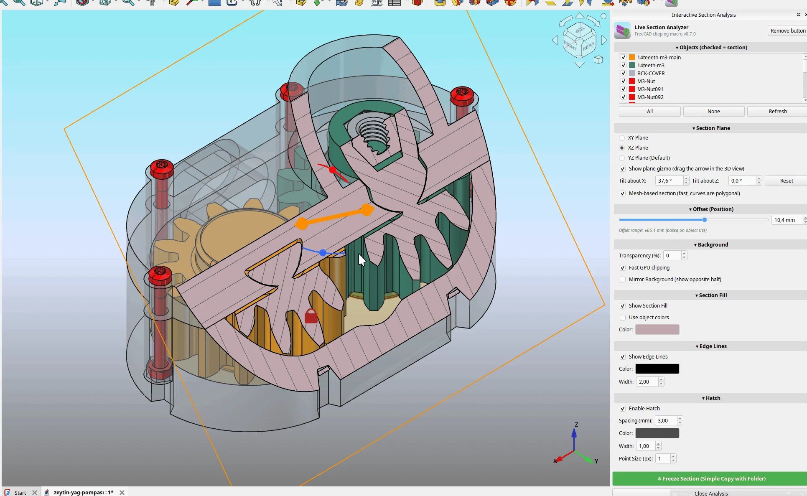

# FreeCAD LiveSectionAnalyzer

**FreeCAD için etkileşimli, gerçek zamanlı kesit görünümü** – katı modeli bir düzlemle kırpın, düzlemi 3B gizmo ile sürükleyin ve hareket ettikçe güncellenen taramalı kesiti görün.

[English](README.md)

## Özellikler

- XY, XZ veya YZ düzleminde **canlı kesit**; kaydırıcı, sayı kutusu veya **3B görünümde gizmo sürükleyerek** hareket.
- **Birden fazla obje ve montaj** – kesit alınacak parçaları listeden seçin; düzlem ekranda gördüğünüz her şeyi kırpar, böylece parçalar arası boşlukları kontrol edebilirsiniz. App::Part ve link içindeki parçalar montaj konumunu korur.
- **Seçenekler kendi dock penceresinde** – kaydırılabilir, açılır bölümler; istediğin yere sürükleyebilir veya yüzdürebilirsin. Tasks paneli ölçü alma gibi işler için boş kalır (`PANEL_MODE = "task"` seçenekleri yine Tasks paneline koyar).
- **Hızlı GPU kırpma** (Coin3D `SoClipPlane`) – her harekette boolean kesme yapılmaz; karmaşık parçalarda bile akıcıdır.
- **Eğik kesit düzlemi** – düzlemi gizmodaki iki döndürme tutamacıyla (kırmızı / mavi top) veya açı kutularıyla eğ; tarama, dolgu, mesh/gerçek motor ve *Freeze Section* ile çalışır.
- **Mesh tabanlı kesit** (varsayılan açık) – kontur, tarama ve dolgu OpenCascade yerine tessellation'dan üretilir; büyük montajlarda ve eğrili parçalarda düzlemi sürüklemek akıcı kalır (17 parçalı pompa montajında güncelleme başına 10–30 ms). Her parça kendi tarama yönünü alır. *Freeze Section* her zaman gerçek geometri kullanır; canlı görünümde gerçek motoru istersen seçeneği kapat.
- Gerçek kesitten (`Shape.slice`) üretilen **kesit konturu, dolgu ve tarama**; renk, çizgi kalınlığı, tarama aralığı ve nokta boyutu ayarlanabilir.
- **Mirror Background** – parçanın karşı yarısını gösterir. Sadece kesme düzlemi değişir; obje hareket etmez.
- **Freeze Section** – mevcut görünümü bağımsız FreeCAD nesneleri olarak bir grupta saklar.
- Arka plan saydamlığı; GPU kırpma kapalıyken boolean kesme modu.

### Mirror Background

## Kurulum

1. [`macro/LiveSectionAnalyzer.FCMacro`](macro/LiveSectionAnalyzer.FCMacro) dosyasını indirin.
2. FreeCAD makro klasörüne kopyalayın (**Makro → Makrolar…** yolu gösterir; Linux'ta genelde `~/.local/share/FreeCAD/v1-1/Macro/` (FreeCAD 1.1)).
3. **Makro → Makrolar…** üzerinden çalıştırın.
4. İsteğe bağlı: paneldeki **Add to toolbar** düğmesine basın. Her workbench'te görünen bir *Live Section* araç çubuğu ve düğmesi eklenir; **Shift+S** boştaysa kısayol olarak atanır. Aynı düğme kaldırır.

Gelecek planlar için: [docs/ROADMAP.md](docs/ROADMAP.md)

## Kullanım

1. İsterseniz ağaçtan bir veya birkaç katı model seçin. Seçim yoksa görünen her şey kırpılır.
2. Makroyu çalıştırın; seçenekler sağ tarafta kendi dock penceresinde açılır.
3. Düzlemi (XY / XZ / YZ) seçin ve hareket ettirin: 3B görünümdeki turuncu oku sürükleyin veya kaydırıcı / sayı kutusunu kullanın.
4. Panelden dolgu, kenar, tarama ve saydamlığı ayarlayın.
5. Sonucu saklamak için **Freeze Section**, geçici nesneleri kaldırmak için **Close Analysis**.

## Test edilen sürümler

FreeCAD 1.1.4 ve 27.1 geliştirme sürümü, Linux (Manjaro). Windows ve macOS test edilmedi.

## Sınırlamalar

- Geçerli şekle sahip tek bir nesne üzerinde çalışır.
- GPU kırpma yalnızca görüntüyü değiştirir; *Freeze* ve GPU kırpma kapalıyken gerçek boolean kesme kullanılır.
- Tarama çizgisi sayısı `MAX_HATCH_LINES = 1500` ile sınırlıdır.
- Yanlış yarı kırpılıyorsa makronun başındaki `CLIP_KEEP_NEGATIVE` değerini ters çevirin.

## Lisans

MIT – bkz. [LICENSE](LICENSE). © 2026 Sedat Kuran
